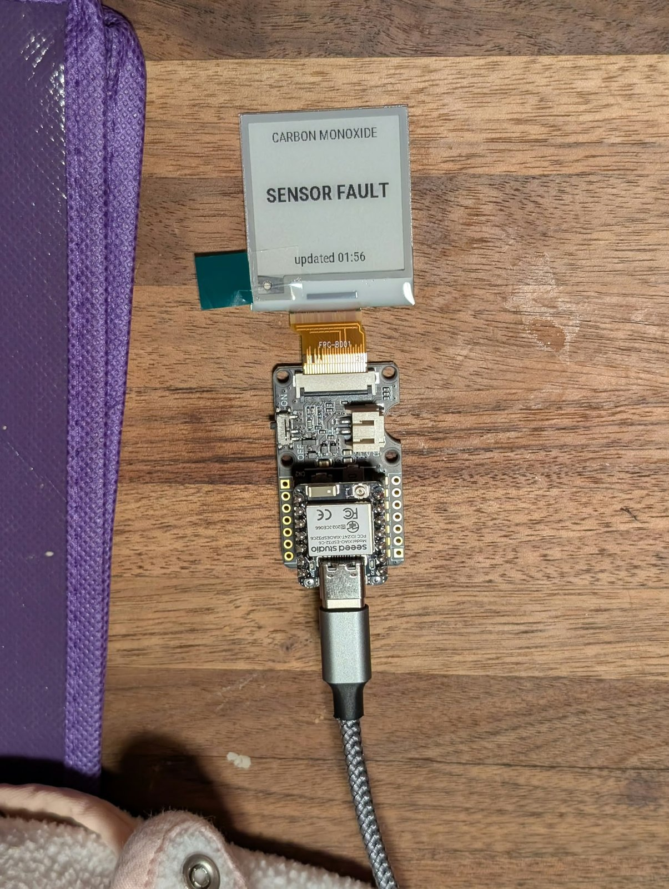

# co-sensor

A small, realtime carbon monoxide sensor: a Winsen ZE15-CO electrochemical module read by
a Seeed XIAO ESP32-C6, showing the current level on an e-ink display. It's built on
ESPHome, so it can also report to Home Assistant (or anything else ESPHome talks to), but
it doesn't need to: with the display attached it's a self-contained device that keeps
working with no network at all.



> **Not a life-safety device.** Winsen states the module must not be used in systems
> related to human safety. Keep a certified CO alarm (UL 2034 / EN 50291) in the home;
> this sensor is for visibility and automation, not protection.

## Status

| Milestone | Scope | State |
|---|---|---|
| M1 | ZE15 → XIAO, readings verified end to end | firmware done; units flashed, onboarded and in Home Assistant. ZE15s arrived; sensor bring-up next ([bring-up](docs/bringup.md)) |
| M2 | Custom PCB: a small **sensor board** (ZE15 in sockets) on a short cable to the driver board | proposed, not designed. The first design, [carrier v0.2](hardware/carrier/README.md), is shelved |
| M3 | 1.54" e-ink display on Seeed's ePaper Driver Board | **working on hardware** (display enabled in the firmware) |
| M4 | Enclosure | **next**: requirements gathered, design not started ([enclosure](enclosure/README.md)) |

[RESUME.md](RESUME.md) is the handoff: current state, open decisions and next steps.

See [docs/plan.md](docs/plan.md) for the milestone plan and the decisions that keep
later milestones from forcing rework.

## Layout

```
firmware/
  co-sensor.yaml                  the product: a name + a list of packages
  common/base.yaml                identity, Wi-Fi, OTA, clock (every device)
  boards/xiao-esp32c6.yaml        logical pin roles -> this board's GPIOs
  modules/ze15.yaml               the CO sensor; publishes `co_ppm` and `co_fault`
  modules/co-lifecycle.yaml       CO cell install date, age and replacement-due flag
  modules/epd-1in54.yaml          the display; consumes `co_ppm`, `co_fault`, replacement-due
  integrations/home-assistant.yaml  optional: ESPHome native API for Home Assistant
  components/ze15_co/             ESPHome external component for the ZE15-CO
  include/tz_label.h              timezone abbreviation for the display (host-tested)
tests/
  unit/                           host-side tests for the firmware's pure C++ helpers
  firmware/                       configs that validate/compile the real firmware
docs/                             plan, wiring, bill of materials, bring-up, onboarding,
                                  maintenance, integrations
hardware/measurements.md          dimensions measured on the real hardware, with photos/
hardware/carrier/                 carrier PCB v0.2 (shelved), generated by a KiCad script
enclosure/                        CadQuery assembly model + renderer; the enclosure goes here
tools/cad.Dockerfile              CadQuery image for the mechanical models
```

The firmware is split along the same lines as the hardware:

- A **board** package maps logical pin roles (`pin_co_rx`, `pin_epd_cs`, ...) to GPIOs.
- **Modules** only refer to those roles and talk to each other through entity ids, not
  hardware: the display reads `co_ppm`; it doesn't know there's a UART.
- **Integrations** are optional consumers of those same entities. The device behaves
  identically with or without them, and never reboots for lack of Wi-Fi or a client.

Swapping the MCU means writing one board file; adding the display or an integration
means adding one package line.

## Quick start

Everything runs through Docker; nothing needs installing besides `make`, `g++` and Docker.

```sh
make run PORT=/dev/ttyACM0     # first flash over USB; later `make run` flashes over Wi-Fi
make logs PORT=/dev/ttyACM0    # follow logs over USB (over Wi-Fi needs the HA/API integration)
```

The firmware contains **no credentials**: no Wi-Fi details, keys or passwords. Every unit
runs the same image and names itself at boot from its MAC address, e.g.
`co-sensor-3fa2c1`; that name is its hostname, its setup hotspot and its Home Assistant
device. After flashing:

1. Join the unit's hotspot and pick your Wi-Fi network.
2. Adopt it in Home Assistant, which gives it a unique encryption key.

See [docs/onboarding.md](docs/onboarding.md), which also covers update security and
adopting the firmware with your own password.

## Tests

```sh
make test       # host unit tests + `esphome config` on every firmware config
make compile    # full firmware builds (first run downloads the ESP-IDF toolchain)
make carrier    # regenerate the carrier PCB and run KiCad's design-rule check
make carrier-check  # printable 1:1 footprint check (the ZE15 outline is still useful)
make assembly   # 3D model + renders (still models carrier v0.2; see enclosure/README.md)
```

- `tests/unit/test_ze15_protocol.cpp` covers checksum maths against the manual's examples,
  frame decoding (fault bit, decimal scaling, Q&A frames, foreign gas types) and stream
  resynchronisation (garbage, truncated frames, checksum errors, `0xFF` in payloads).
- `tests/unit/test_tz_label.cpp` covers the display's timezone labels (CST/CDT, CEST,
  AEDT, ...) and the numeric fallback for ambiguous zones (`UTC+8`, `UTC+5:45`).
- `tests/firmware/` builds:
  - `co-sensor`: the real device config, display included;
  - `co-sensor-adopted`: an owner's adopted config (product image + update password);
  - `co-sensor-standalone`: sensor + display with **no** integrations, which guards
    against modules quietly depending on Home Assistant.

## Readings

The ZE15 module publishes two values, which the display and any integration consume:

| Id | Meaning |
|---|---|
| `co_ppm` | CO in ppm, 0.1 resolution: the average of the module's 1 Hz readings, published once per **Update interval** (default 15 s, adjustable from Home Assistant). The display refreshes with each one. NaN (unknown) during the 60 s warm-up, while the module reports a fault, and when no valid frame has arrived for 10 s, so a dead sensor never reads as "0 ppm". |
| `co_fault` | On when the module reports a fault or has stopped reporting. |

The CO cell is a consumable that ages even unpowered, so `modules/co-lifecycle.yaml`
keeps its install date in the device's flash. It publishes `co_cell_age` (days) and
`co_cell_replacement_due`, with a "replaced" button and an editable service life. See
[docs/maintenance.md](docs/maintenance.md).
