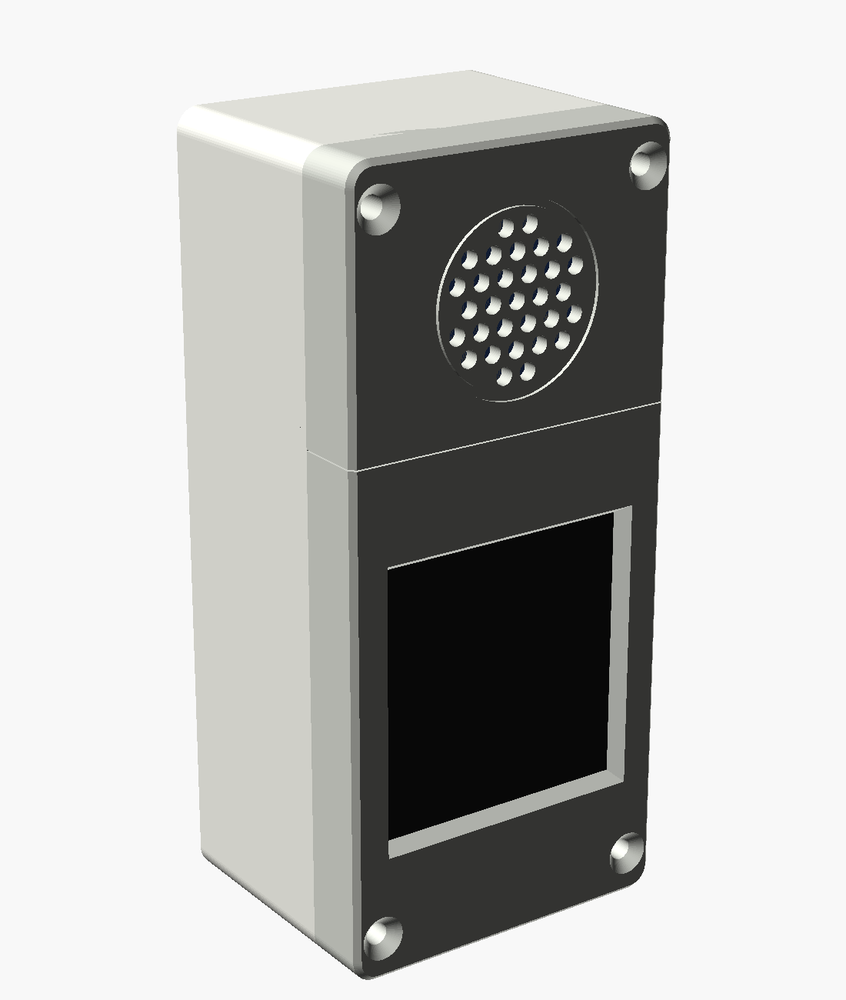
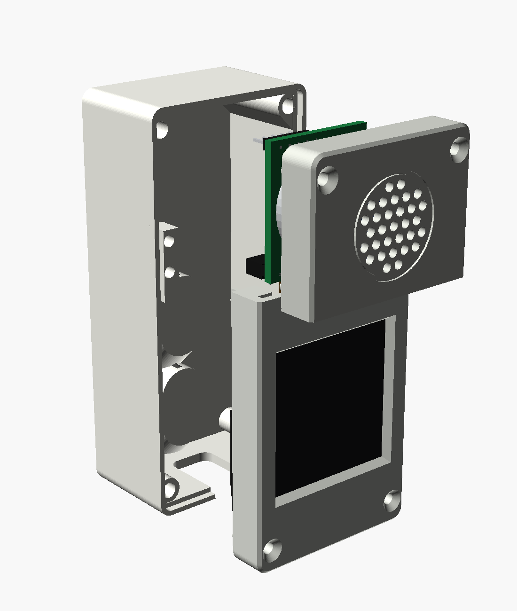
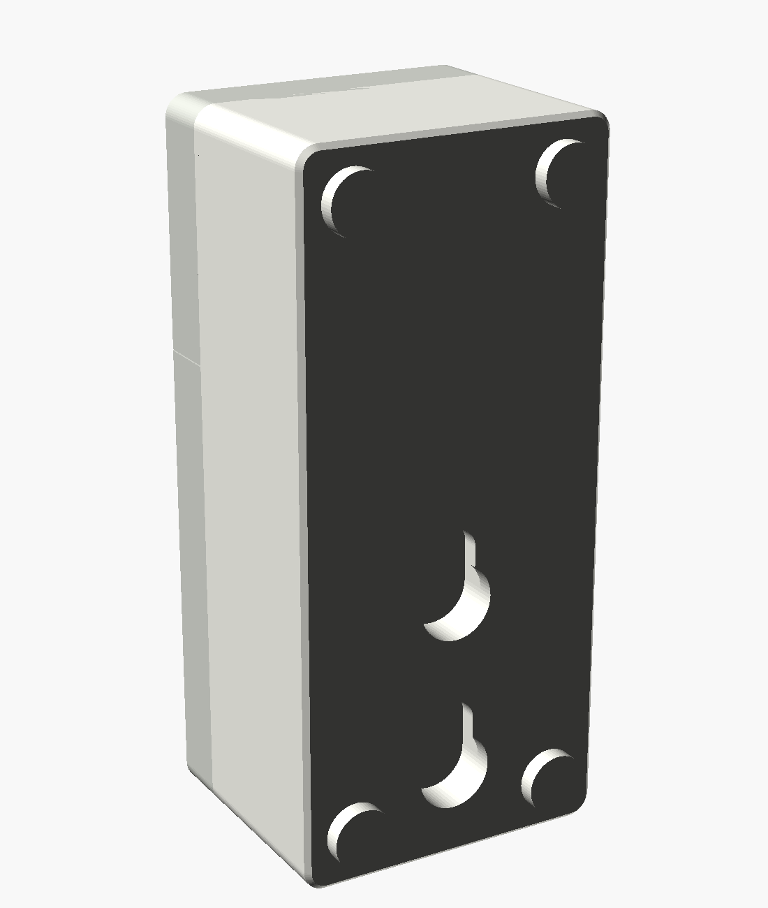

# Enclosure

A wall-mounted case in three printed parts, designed in OpenSCAD. Overall size:
**36.6 W × 81 H × 30.3 D mm**, plus 2 mm feet on the back.

  

**Orientation terms** (used throughout the repo):
- **bottom:** the USB-C end; **top:** the display-ribbon end.
- **front:** where the display faces out; **back:** the wall side.
- **width, depth, height** follow from those.

## The parts

| Part | File | What it does |
|---|---|---|
| Body | `stl/body.stl` | Screws to the wall through two keyholes; four 2 mm feet. Holds nothing itself. It has four M2 heat-set inserts for the faces, bosses for their locating pins, and the back half of the USB-C opening. |
| Display face | `stl/display-face.stl` | The lower front, with the display window. The panel slides into a slot behind the window from the top. The driver board rests on two rails behind the slot (on its 1 mm solder tails) and screws to them through its top two mounting holes. A tab fills the front half of the USB-C opening. |
| Sensor face | `stl/sensor-face.stl` | The upper front: a grille, and four spring fingers that grip the ZE15's can. The can presses in from behind and pulls out. |

Each face is held by **two M2 screws** at its outer corners and **two pins** at its inner
corners that drop into bosses on the body's side walls. A lip around each face seats in a
rebate around the body's front rim. **Either face comes straight off forward without
disturbing the other**, so you can replace the sensor or service the display with the body
still on the wall.

## How it goes together

1. Solder the sensor cable (see [the plug](#the-sensor-plug)) and press the four heat-set
   inserts into the body's corner bosses.
2. **Display face**, lying face down:
   - Slide the panel into its slot from the top, face toward the window, ribbon end up.
   - Lay the driver board (with the XIAO) on the rails, its USB-C port through the tab's
     cut-out, and fit two M2 × 4 screws through its top mounting holes.
   - Fold the ribbon over the board's top edge and latch it into the connector.
3. **Sensor face**, lying face down: press the ZE15 in, can first, until it sits against the
   grille. Push the plug onto its 10-pin row, legs toward the display.
4. Screw the body to the wall. Fit the display face, then the sensor face; each takes two
   M2 × 12 flat-head screws.

## The sensor plug

A **Sullins NPPN101FGGN-RC** (2.0 mm, 1 × 10, right-angle female socket) pushes onto the
ZE15's 10-pin row, with its legs pointing down toward the display. Three of its legs carry
wires to the driver board:

| ZE15 pin | Signal | Leg (seen from the front) | Wire | Driver board hole |
|---|---|---|---|---|
| 15 | Vin | rightmost | red | 5V |
| 14 | GND | second from the right | black | GND |
| 8 | TXD | eighth from the right | yellow | D7 |

The other seven legs are clipped off. Solder the wires before the plug goes anywhere near
the sensor (the cell is heat-sensitive), with 26 AWG PVC-insulated wire and 1/16" plain
(non-adhesive) heat-shrink: no silicone near the sensor (see [BOM, order 3](../docs/bom.md#order-3-the-sensor-plug-and-the-enclosures-hardware)).

Pin 15 is at the right-hand end because Winsen's drawing is a top view (confirmed by the
printed footprint test), and the 10-pin row runs along the bottom with the can facing
front. That puts 5V and GND right above the driver board's 5V…D7 column, which is on the
right as well.

## Printing

All three parts print **without supports**, in the orientation of their file:

| Part | Orientation |
|---|---|
| Body | standing on its bottom (USB-C) end |
| Display face | standing on its bottom edge |
| Sensor face | upside down, standing on its top edge |

Printing everything upright puts the layer lines the same way on every visible surface.
Tested with: nothing yet. Intended settings: PLA or PETG, 0.4 mm nozzle, 0.2 mm layers, at
least 4 walls, 20 % infill, and a brim on the two faces (they stand on narrow edges).
Avoid resin prints near the sensor unless fully cured.

## Hardware

| Qty | Part |
|---|---|
| 4 | M2 heat-set inserts, ~3.6 mm outer diameter, up to 4 mm long (3.2 mm holes) |
| 4 | M2 × 12 flat-head (countersunk) screws: faces into the body |
| 2 | M2 × 4 pan-head thread-forming screws for plastic: driver board onto the rails |
| 2 | Wall screws with pan heads up to 8.6 mm across (#6, #8 or M4), and anchors |

## Source

| File | Contents |
|---|---|
| `config.scad` | **Every dimension**: measurements of the purchased parts (from [hardware/measurements.md](../hardware/measurements.md)) and design values. The layout is derived from them. |
| `parts.scad` | The three parts, in device coordinates |
| `body.scad`, `display-face.scad`, `sensor-face.scad` | Print files: one part each, in print orientation |
| `components.scad` | Simplified models of the purchased parts, in place |
| `assembly.scad` | The assembled unit (`explode`, `cutaway` and `show_*` toggles) |
| `checks.scad`, `check.py` | Fit checks: no collisions, and each face comes off on its own |

```sh
make enclosure          # STLs -> stl/, fit checks, renders -> renders/
make enclosure-check    # fit checks only
```

The STLs and renders are committed, so building a unit doesn't need OpenSCAD. Changing the
design does: install OpenSCAD 2021.01 or newer, and `xvfb-run` for headless renders.

## Still estimated

These come from photos or datasheets, not calipers. Each one sits in `config.scad`.

- **`xiao_overhang` (2.7 mm) and `usb_overhang` (5.2 mm):** how far the XIAO's own board
  and the USB-C port's face stick out past the driver board's bottom edge. Together they set
  the height and where the port meets the bottom surface. Kael measured "about 2 mm"; a
  photo suggests that was the port past the XIAO's board.
- **`ze15_pin_exposed` (3.4 mm):** how much of the ZE15's pins stands above their plastic
  strip. It sets how far back the plug sits, and so the depth.
- **`ze15_pcb_t` (1.6 mm):** the ZE15's board thickness.
